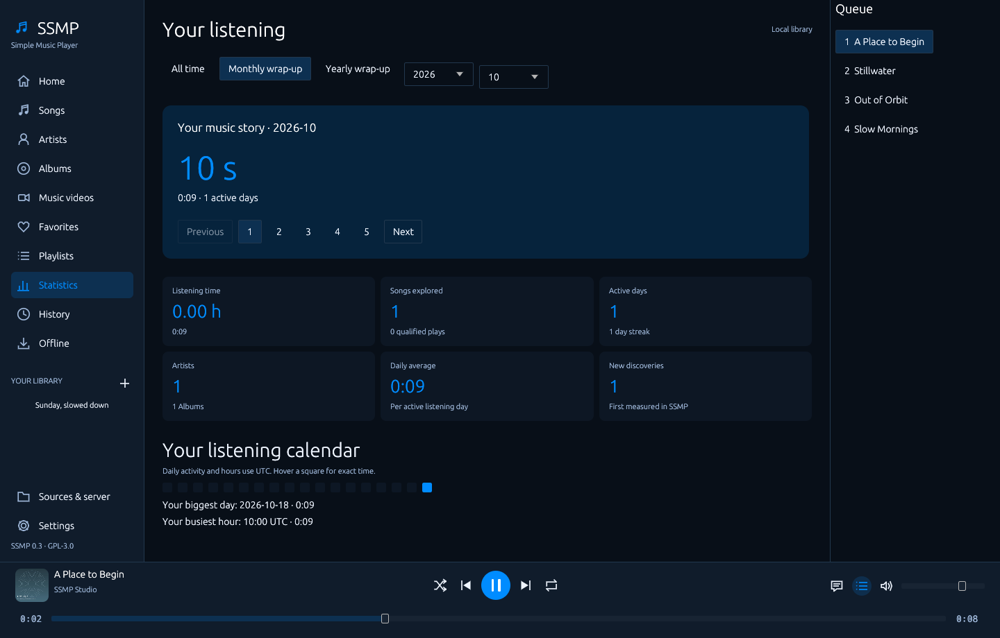
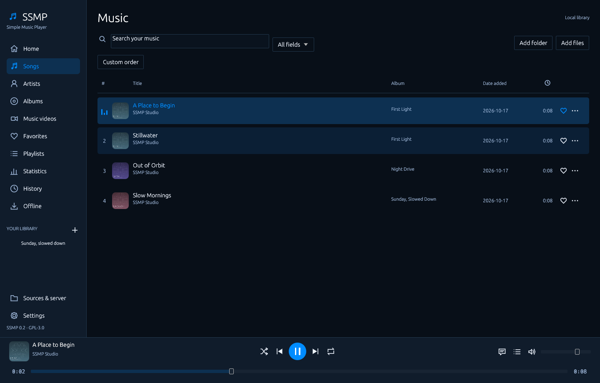

# SSMP

**Slulisee's Simple Music Player** — a native, local-first music player with optional personal hosting. No account, ads or internet connection is needed for local listening.

Version **0.3.0** adds monthly/yearly listening wrap-ups, richer measured statistics, batch selection/editing, direct metadata and lyric actions, compact dialogs, stable interface scaling, a Windows installer and verified automatic updates after closing. General series/video-library screens have been removed; music videos stay supported.

## Start on Windows

Run **SSMP-Windows-AMD64-Setup.exe** from [Releases](https://github.com/Slulisee/SSMP/releases/latest), or extract the complete `SSMP-0.3.0-windows-x64.zip` and open `SSMP.exe`. Keep `libunwind.dll` and `tools/` beside it. Add a folder or drop music into the window. Data is stored in `%LOCALAPPDATA%\SSMP`; `SSMP.exe --data PATH` selects a separate library. Existing libraries migrate using defaults for new fields.

Windows setup and portable artifacts are published after the release checks pass. See [install/update guidance](docs/UPDATES.md). Current platform and release boundaries are listed in [RELEASE-CHECKLIST.md](RELEASE-CHECKLIST.md).

## New in 0.3

- Monthly/yearly stories, measured period rankings and replay playlists; detailed coverage is shown for older libraries.
- Import LRC/text lyrics, search with visible results, and keep lyrics and queue open together.
- Select multiple tracks and edit only checked fields, add them to playlists or look up their missing information.
- Scaling applies after release; small/high-scale windows adapt their navigation and transport layout.
- [Windows updates](docs/UPDATES.md) run after closing, and a [Docker host](docs/DOCKER.md) preserves its data volume.

[Batch editing example](docs/images/batch-edit.png)

## Music, your way

- A wide seek rail previews while dragging and seeks once on release. Previous restarts after three seconds; a quick second press goes back. Shuffle toggles without starting a song.
- Songs, artists and albums; clickable artist/album names, favorite artists with optional shuffle weighting, and album-to-playlist conversion.
- Playlist pictures/descriptions, add-installed-songs selection, track count, total length, measured playlist listening time, date-added columns, sorting, search filters and custom ordering. Right-click and the three-dot menu share actions.
- Synced local LRC, enhanced word timing, full-screen lyrics with artwork background, optional online lookup and timing adjustment.
- Music videos and linked local video, with a picture/audio-only switch that preserves playback.
- Actual listening seconds/hours, play counts, top songs/artists/genres, daily activity, streaks, busiest hour, genre coverage and JSON export. Measurement is optional and clearable.
- English, German, Spanish and French; sixteen themes, custom accents, scale, compact rows and reduced motion.
- Cached CPU window drawing on Windows, visible-row rendering, cached search and selected-track-only queue resolution. Optional GPU diagnostic backends remain available.
- Optional MusicBrainz/Cover Art Archive/LRCLIB enrichment, protected manual edits, background folder watching, output-device selection and loudness normalization.
- Authenticated self-hosting, individual profiles, range streaming, revision checks, offline copying and SSYTDLP completed-download handoff.

The [compact capture](docs/images/player-compact.png) uses the same application at 1000 × 720. Screenshots use generated demonstration media.

## Guides

- [Music guide](docs/MUSIC-GUIDE.md): playback, playlists, lyrics, customization and statistics.
- [Hosting](docs/HOSTING.md): accounts, LAN/Tailscale, headless hosting and backups.
- [Imports](docs/IMPORTS.md): local playlists, lyrics and downloader integration.
- [Architecture](docs/ARCHITECTURE.md), [specification](SPECIFICATION.md), [changelog](CHANGELOG.md), and [third-party notices](docs/THIRD-PARTY.md).

## Build and verify

Use stable Rust: `cargo build --release --locked` for desktop, or `cargo build --release --locked --no-default-features` for a headless host. Linux/macOS desktop installations need libmpv and ffprobe. Windows portable packages supply the playback runtime. `scripts/build.ps1` supports the local Windows toolchain.

`cargo test --locked` runs regression tests. `scripts/qa.py`, `scripts/music_playback_qa.py`, `scripts/music_ui_qa.py` and `scripts/music_v03_qa.py` use generated media and disposable profiles. `scripts/prepare_music_runtime.py`, `scripts/build_music_installer.py` and `scripts/zip_music_runtime.py` assemble the pinned Windows packages. Binaries, credentials, libraries, queues and machine-specific reports stay out of Git.

## License and next platforms

SSMP is GPL-3.0-or-later, without a resale restriction. The independent SSYTDLP code retains its MIT license. Dependencies retain their own licenses and notices.

Linux/macOS native packages, mobile clients, system media-key/tray integration, additional server adapters, advanced DSP/crossfade and expanded import providers remain separate work. See the release checklist for what has actually been executed.
